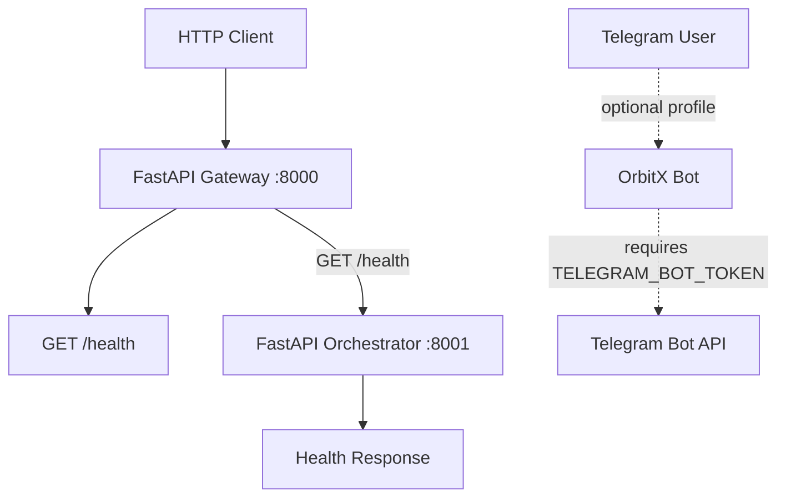

# SINC-OS

[](https://www.python.org/)
[](https://fastapi.tiangolo.com/)
[](https://docs.docker.com/compose/)
[](.github/workflows/ci.yml)
[](#proof-of-concept--enterprise-customization-readiness)

**SINC-OS currently contains two separate proof-of-concept tracks: a small FastAPI Gateway/Orchestrator service slice and an optional Telegram bot entry point named OrbitX.**

These tracks are not integrated. The service stack currently exposes health endpoints only; it does not execute tasks, coordinate agents, or persist workflow state. The previously described authorized-media/YouTube processing workflow is not present in the current repository tree and must not be treated as implemented.

## 1. Project Overview & Problem Statement

The repository has accumulated multiple experimental directions. The current service slice tests a minimal internal service boundary: a public-facing gateway proxies health checks to a private orchestrator container, propagates a correlation ID, applies an upstream timeout, and returns a sanitized unavailable response.

A separate optional OrbitX Telegram bot provides only a minimal `/start` response. Neither track currently provides a production agent platform or media-processing service.

### Current architecture



The Orchestrator is not exposed directly to the host in the default Compose stack. Only the Gateway port is published.

## 2. Tech Stack & Versions

| Component | Technology |
|---|---|
| Runtime | Python 3.11 |
| API framework | FastAPI `>=0.115,<1` |
| ASGI server | Uvicorn `>=0.30,<1` |
| HTTP client | httpx `>=0.27,<1` |
| Structured logging | structlog `>=24.4,<26` |
| Optional Telegram bot | pyTelegramBotAPI `>=4.22,<5` |
| Containers | Docker / Docker Compose |
| CI | GitHub Actions, Python unittest, compileall, Compose validation and image builds |

Dependencies are declared as version ranges in [`requirements.txt`](requirements.txt); no lockfile is present. CI installs Python 3.11 dependencies and builds the Gateway, Orchestrator, and optional OrbitX images.

## 3. Prerequisites & Dependencies

For the service stack:

- Git.
- Docker Engine.
- Docker Compose plugin.

For local Python tests or running an individual service:

- Python 3.11.
- pip.
- Dependencies from `requirements.txt`.

For the optional OrbitX bot:

- A Telegram bot token created through the official Telegram bot setup.
- A private environment variable named `TELEGRAM_BOT_TOKEN`.

No Redis server, database, model, hosted AI API, or paid service is required by the current Gateway/Orchestrator health-only slice.

## 4. Installation & Local Setup

Clone the repository:

```bash
git clone https://github.com/zopair/SINC-OS.git
cd SINC-OS
```

### Start the Gateway and Orchestrator

```bash
docker compose config --quiet
docker compose up --build -d
docker compose ps
```

Verify the health endpoints:

```bash
curl http://localhost:8000/health
curl http://localhost:8000/orchestrator/health
```

The Orchestrator listens on port 8001 inside the Compose network. It is not published to the host by default.

Stop the stack:

```bash
docker compose down
```

### Run the service tests locally

```bash
python -m pip install -r requirements.txt
python -m compileall -q orbitx_final.py services tests
python -m unittest discover -s tests -v
```

### Run OrbitX separately (optional)

```bash
TELEGRAM_BOT_TOKEN="your-token" docker compose --profile bot up --build -d orbitx
```

Keep the token in a local untracked `.env` file or a secret manager; never commit it. The bot currently implements only a minimal `/start` handler.

## 5. Environment Variables

| Variable | Used by | Purpose / current status |
|---|---|---|
| `ORCHESTRATOR_URL` | Gateway container | Upstream Orchestrator URL; Compose sets it to `http://orchestrator:8001` |
| `TELEGRAM_BOT_TOKEN` | Optional OrbitX bot | Required only when starting the bot |
| `REDIS_URL` | `.env.example` placeholder | No Redis service or consumer is configured in the current Compose stack |
| `NODE_ENV` | `.env.example` placeholder | Not used by the current Python services |

The checked-in `.env.example` contains placeholders only. The default Gateway/Orchestrator services do not require secrets.

## 6. Usage Guide & Core Features

### A. FastAPI Gateway

The Gateway exposes:

- `GET /health` — Gateway liveness response.
- `GET /orchestrator/health` — proxies the internal Orchestrator health endpoint.

It preserves an incoming `X-Correlation-ID` or generates one, logs request path and elapsed time, and returns a sanitized HTTP 503 if the upstream health call fails. The upstream request timeout is five seconds.

### B. FastAPI Orchestrator

The Orchestrator currently exposes only:

- `GET /health` — returns its service status and `persistence: not_configured`.

There is no task submission endpoint, queue consumer, workflow scheduler, agent execution engine, database persistence, retry mechanism, or tenant authorization in this service slice.

### C. Optional OrbitX Telegram bot

The root `Dockerfile` builds the optional bot, which is excluded from the default Compose profile. It requires `TELEGRAM_BOT_TOKEN` and currently responds to `/start` only.

### D. Legacy / unimplemented tracks

- **Authorized media / YouTube workflow:** the current tree does not contain a media processing workflow file or the media downloader/transcoder implementation described in older README text. The CI workflow only compiles/tests Python and builds Docker images.
- **YouTube OAuth secrets:** `SOURCE_CHANNELS`, `YOUTUBE_TOKEN_JSON`, and `YOUTUBE_CLIENT_SECRETS_JSON` are not part of the current `.env.example` or active CI workflow.
- **Redis:** `REDIS_URL` appears in the example environment file, but Compose does not provision Redis and the Gateway/Orchestrator do not consume it.
- **Architecture document:** `ARCHITECTURE.md` currently refers to a different project label (Cloudy_Lap_top / CLT) and is not a reliable description of the current SINC-OS service stack.
- **GitHub deploy helper:** `deploy_to_github.py` is a separate repository-creation/upload script requiring a token with repository write permissions. It is not part of CI or normal service startup; review its upload scope before running it.

See [Services README](services/README.md) for the focused service architecture and operational commands.

## 7. Live Demo & Screenshots

SINC-OS is a Docker Compose PoC, not a hosted public web application. No GitHub Pages deployment workflow or live public service URL is configured in the reviewed tree.

The reproducible demonstration is the local Compose stack:

- Gateway: `http://localhost:8000/health`
- Orchestrator through Gateway: `http://localhost:8000/orchestrator/health`

The optional Telegram bot requires a private token and is not automatically started.

## 8. Testing & Verification

Run the test suite:

```bash
python -m unittest discover -s tests -v
```

Run the same core validation steps used in CI:

```bash
python -m compileall -q orbitx_final.py services tests
docker compose config --quiet
docker compose build gateway orchestrator
docker build -t sinc-os-orbitx .
```

The current tests cover:

- Gateway health endpoint.
- Orchestrator health endpoint.
- Correlation ID preservation by the Gateway.

### CI evidence observed during this review

- **SINC-OS CI:** [run #44673851192](https://github.com/zopair/SINC-OS/actions/runs/44673851192) on 20 November 2026 — Success.
- The successful job compiled the Python services, ran the unit tests, validated Docker Compose, and built the Gateway, Orchestrator, and optional OrbitX images.
- This is CI evidence for those checks only. It does not prove a deployed service, working task orchestrator, media-processing workflow, or Telegram bot connected to a live token.

## Proof of Concept & Enterprise Customization Readiness

**Status: Small service PoC + optional bot stub.**

| Capability | Verified state |
|---|---|
| Gateway health endpoint | Implemented |
| Orchestrator health endpoint | Implemented |
| Gateway health proxy | Implemented with timeout and sanitized 503 |
| Correlation ID | Implemented |
| Docker Compose service stack | Implemented and CI-validated |
| Non-root container users | Configured in service Dockerfiles |
| OrbitX Telegram bot | Minimal `/start` handler; optional profile only |
| Task execution / orchestration | Not implemented |
| Durable state / Redis | Not implemented or configured |
| Authentication / authorization | Not implemented |
| Media / YouTube pipeline | Not present in the current repository tree |
| Deployment / hosting | No live deployment verified |
| License | No root `LICENSE` file was present in the reviewed tree |

### Enterprise readiness gates

1. Define task contracts and execution semantics before expanding the Orchestrator.
2. Add persistence and a queue only when a real workflow requires them; do not imply Redis is active before provisioning and testing it.
3. Implement authentication, authorization, rate limits, audit events, and tenant boundaries before exposing task endpoints.
4. Integrate media processing only as a separate approved component with explicit source rights and OAuth scopes.
5. Add integration tests for failure, timeout, restart, and recovery behavior.
6. Select a project license and review third-party dependency terms before redistribution.

## Intellectual Property & Authorship

Project authorship and attribution: **Aly Hussein Zopair (علي حسين زبير ALY HUSSEIN ZOPAIR)**.

This notice does not replace a software license or override the licenses of FastAPI, Uvicorn, httpx, structlog, pyTelegramBotAPI, Docker base images, or other third-party components.
