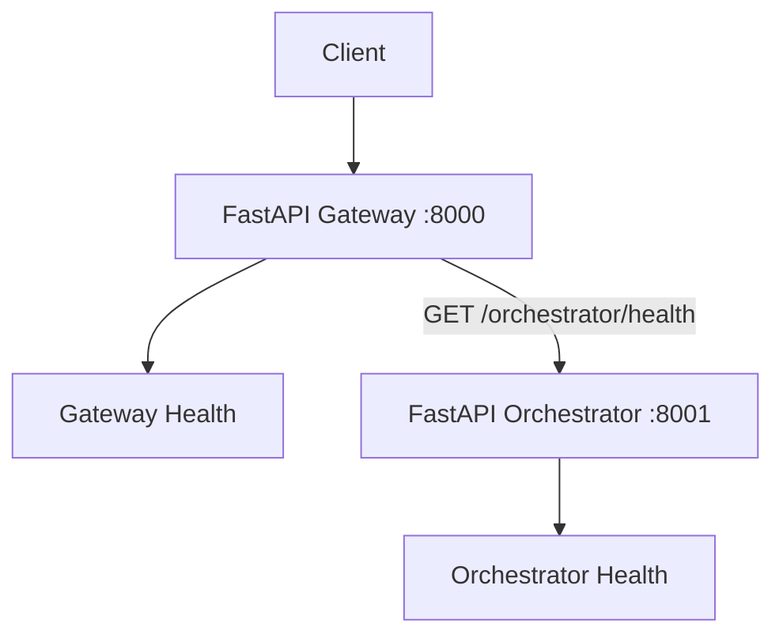

# SINC-OS Services

[](https://github.com/zopair/SINC-OS/actions/workflows/ci.yml)

## Business problem

The repository contains more than one technical direction. The media-processing workflow and the FastAPI service stack should not be presented as one integrated runtime until a real interface connects them.

## Current service stack

The current service slice is a small two-container FastAPI prototype:

- **Gateway** on port 8000 exposes liveness and proxies the orchestrator health endpoint.
- **Orchestrator** listens internally on port 8001 and exposes a health endpoint.
- Gateway responses preserve or generate an `X-Correlation-ID`.
- Upstream health calls use a five-second timeout and return a sanitized 503 response when unavailable.
- Containers run as a non-root application user.

## Architecture



## Quick start

Requirements: Docker Engine and Docker Compose.

```bash
docker compose up --build -d
docker compose ps
curl http://localhost:8000/health
curl http://localhost:8000/orchestrator/health
```

Stop the stack:

```bash
docker compose down
```

The orchestrator is not published to the host; only the gateway port is exposed.

## Optional OrbitX bot

The root Dockerfile builds the optional Telegram bot. It is not part of the default Compose services and requires an explicit token:

```bash
TELEGRAM_BOT_TOKEN=... docker compose --profile bot up --build -d orbitx
```

Do not commit the token. The checked-in `.env.example` contains placeholders only.

## Validation

```bash
python -m unittest discover -s tests -v
docker compose config --quiet
docker compose build gateway orchestrator
docker build -t sinc-os-orbitx .
```

CI validates Python compilation and service tests, checks Compose syntax, and builds all three images.

## Proof of Concept & Enterprise Customization Readiness

| Capability | Current status |
|---|---|
| Gateway health | Implemented |
| Orchestrator health | Implemented |
| Health proxy | Implemented with timeout and sanitized errors |
| Correlation ID | Implemented |
| Dockerfiles | Present for gateway, orchestrator, and optional OrbitX bot |
| Task API / agent dispatch | Not implemented |
| Durable persistence | Not configured |
| Redis service | Not provisioned or used by this service slice |
| Authentication / tenant isolation | Not implemented |
| Media workflow integration | Not implemented; separate track |
| Automated tests and image builds | CI checks configured |

**Release posture:** Service PoC only. The orchestrator currently reports health and does not schedule tasks or persist state. Do not market it as a production orchestrator until task contracts, authorization, persistence, retries, and observability are implemented and tested.

## Intellectual Property & Authorship

Project authorship and attribution: **Aly Hussein Zopair (علي حسين زبير ALY HUSSEIN ZOPAIR)**.

This attribution does not replace a legal license. Review upstream and dependency licenses before redistribution.
